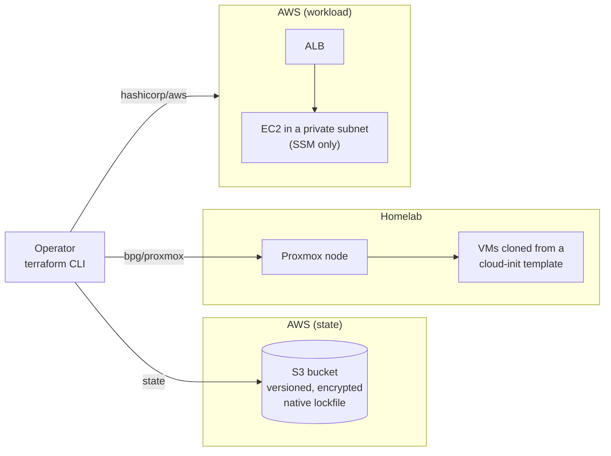

# cloud-lab

> One Terraform codebase that drives a real Proxmox homelab and AWS with the same module contract, remote state with native locking, and no SSH and no public instance IP on the cloud side.

---

## Overview

`cloud-lab` provisions the same kind of workload (a Debian VM that serves nginx) on two very different targets: virtual machines on my own Proxmox node, and an EC2 instance on AWS behind an Application Load Balancer. Both environments share their cloud-init rendering and a common VM module contract, and both keep their state in one versioned, encrypted S3 bucket.



**Stack:** Terraform 1.16+, `bpg/proxmox` 0.116, `hashicorp/aws` 6.x, `hashicorp/http` 3.x, cloud-init, S3 (state), ALB, NAT gateway, SSM Session Manager, gitleaks (pre-commit).

---

## Problem

I wanted a repository that shows how I work with infrastructure as code, not another single-provider tutorial. The constraints that shaped it:

- **One real target and one cloud target.** The homelab is real hardware, so IPs, templates and permissions matter. AWS adds networking, IAM and cost.
- **Cost ceiling.** A NAT gateway and an ALB bill by the hour. The AWS side must be cheap to leave idle and easy to destroy.
- **A single operator, a public repository.** No secrets, no real addresses, and nothing that depends on knowing my machine.
- **No exposed management plane.** The cloud instance must not need a key pair, a bastion or a public IP.

---

## Design decisions

### 1. Two providers, one soft module contract
`vm-proxmox` and `vm-aws` take the same core inputs (`name`, `disk_gb`, `user_data`, `ip_address`) and return the same outputs (`id`, `ip`). Everything provider-specific stays outside that contract: CPU and memory on Proxmox, instance type and subnet on AWS. The user data is rendered once by a `cloud-init` module that knows nothing about any provider.
**Alternatives rejected:** a single "universal" VM module with conditionals for both providers (it would grow a flag per difference), and no shared contract at all (it would duplicate the cloud-init logic).

### 2. State in S3 with the native lockfile, bootstrapped from a local root
A separate `bootstrap/` root creates the bucket with versioning, SSE-S3, public access block, a TLS-only policy and `prevent_destroy`. Its own state is local, which solves the chicken-and-egg problem. Locking uses `use_lockfile = true`, so there is no DynamoDB table to pay for or maintain. → [ADR 0001](docs/decisions/0001-bootstrap-local-state.md)
**Alternatives rejected:** creating the bucket by hand (not reproducible) and S3 plus DynamoDB locking (an extra resource for a feature the backend now has natively).

### 3. SSM Session Manager instead of SSH
The EC2 instance has no key pair, no public IP and no inbound rule for port 22. The module creates the IAM role and instance profile, and the SSM agent is installed from cloud-init because the official Debian AMI does not ship it. → [ADR 0004](docs/decisions/0004-ssm-instead-of-ssh.md)
**Alternatives rejected:** a bastion or an Elastic IP (a host to harden and pay for, and it reverses the "ALB as the only entry point" goal) and EC2 Instance Connect (still SSH).

### 4. A single, ephemeral NAT gateway
Private subnets reach the Internet through one NAT gateway in one AZ. It is applied for a work session and destroyed afterwards. The VPC and subnets cost nothing and stay. The trade-off is a single point of failure for outbound traffic. → [ADR 0003](docs/decisions/0003-single-nat-gateway.md)
**Alternatives rejected:** a NAT per AZ (twice the cost for a lab with no availability requirement), VPC endpoints only (the instance could not install packages) and a NAT instance (patching and sizing by hand).

### 5. Security groups that reference each other
The instance accepts TCP 80 only from the ALB's security group, not from an address range. If the ALB's addresses change, nothing needs to change.

### 6. Version constraints by layer
Roots pin with `~>` and commit the lockfile; modules only declare a floor with `>=`. `bpg/proxmox` is pre-1.0, so it is bounded at the minor. → [ADR 0002](docs/decisions/0002-version-constraints.md)

---

## Implementation

The repository has three independent roots and four modules.

| Path | What it is |
|---|---|
| `bootstrap/` | The state bucket and the monthly budget. Local state |
| `envs/homelab/` | VMs on Proxmox, with `check` blocks that request each VM's nginx page |
| `envs/aws/` | VPC, security groups, ALB and an EC2 instance |
| `modules/` | `cloud-init`, `vm-proxmox`, `vm-aws`, `network-aws`, each with its own README |

Terraform features used on purpose: `for_each` over a map of VMs, `moved` blocks to refactor without recreating anything, `validation` on inputs, `precondition` and `postcondition` on the VM resources, and `check` blocks for non-blocking health checks.

```bash
# 1. Create the state bucket (local state)
cd bootstrap && terraform init && terraform apply

# 2. Plan an environment (remote state in S3)
cd ../envs/aws && terraform init && terraform plan
```

Variables are documented in each `variables.tf`, and `*.tfvars.example` shows the shape of the values. Real `tfvars` files are ignored by git. The full picture, with diagrams, is in [`docs/architecture.md`](docs/architecture.md).

---

## Result

- `curl` to the ALB's DNS name returns `200 OK` with the nginx page, while the instance sits in a private subnet with no public IP and no SSH.
- The instance registers in SSM as `Online`, and `aws ssm start-session` opens a shell.
- `terraform plan` on `envs/homelab` reports `No changes` after a refactor that moved the nginx start-up command out of the module template, which confirms that the rendered user data did not change.
- A budget that I created by hand was imported with an `import` block, and a later `plan` shows no changes.
- Drift introduced from the AWS console is detected by `plan` and reverted with a targeted `apply`.
- A history scan with gitleaks over every commit finds no secrets, and a pre-commit hook runs it on each new commit.
- Cost: the idle AWS footprint is free. A forgotten NAT gateway would cost around 33 USD a month, so a budget alarm is part of the code.

---

## Lessons learned

- **The module is not the whole story.** The role and instance profile are not enough for SSM on Debian: the AMI has no agent, and the fix (installing the `.deb` from cloud-init) belongs in the environment, not in the module, so the contract does not change.
- **Terraform only sees what it manages.** A rule added by hand to a security group whose rules are separate resources does not show up in `plan` and is not reverted. That is documented provider behaviour. Detecting it needs a control outside Terraform, such as AWS Config.
- **`precondition` and `depends_on` interact.** With `depends_on` on the calling module, a data source inside is read at apply time, so a precondition that depends on it is not evaluated during `plan`.
- **`-target` is an exception.** It saved money by destroying only the billable resources, but it leaves a partial state that makes the next plan noisy.
- **Import is not "done" when it succeeds.** The first `plan` after importing the budget showed three differences between my code and the real resource. The plan is the test.

---

## Stack & concepts applied

**Infrastructure as code:** modules with a shared contract, remote state and locking, `import`, `moved`, `validation`, `precondition`, `postcondition`, `check`, version constraints and lockfiles.
**Security:** no SSH, SSM with IAM, IMDSv2, encrypted volumes and state, TLS-only bucket policy, security groups by reference, secret scanning in pre-commit.
**Operations:** drift detection, targeted destroys, cost control with a budget and ephemeral resources, debugging with `TF_LOG`.
**Cloud / platform:** VPC design, ALB and target groups, NAT, IAM, Proxmox with cloud-init templates.

---

## Project status

| Milestone | Status |
|---|---|
| Proxmox environment and VM modules | ✅ 2026-10-18 |
| Remote state in S3 with locking | ✅ 2026-10-19 |
| AWS network and VM modules, SSM access | ✅ 2026-10-24 |
| ALB in front of a private instance | ✅ 2026-10-24 |
| Drift, import and debugging practice | ✅ 2026-10-25 |
| Docs, ADRs and module READMEs | ✅ 2026-10-25 |
| v2: GitHub Actions with OIDC (`plan` on pull request, `apply` on merge) | ⏳ |
| v2: application on k3s | ⏳ |
| v3: PostgreSQL | ⏳ |

This is v1. There is no CI yet, no HTTPS on the ALB and no NAT gateway per AZ; the reasoning is in the ADRs and the architecture document.

---

## Additional documentation

- [`docs/architecture.md`](docs/architecture.md) — topology of both environments, the state flow and the module contract.
- [`docs/decisions/`](docs/decisions/) — architecture decision records.
- [`modules/README.md`](modules/README.md) — the common VM contract; each module also has its own README.
- `*.tfvars.example` — sanitized example values for `bootstrap/` and `envs/homelab/`.
