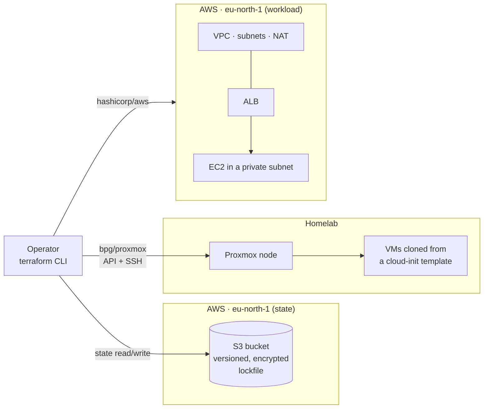
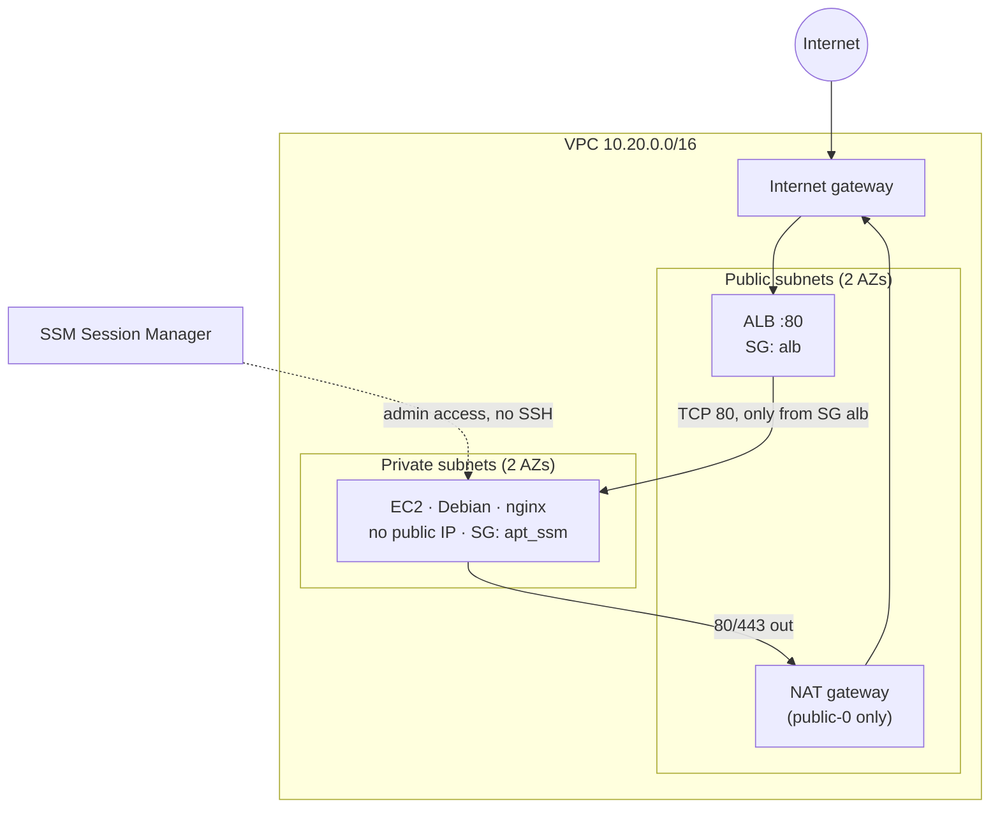
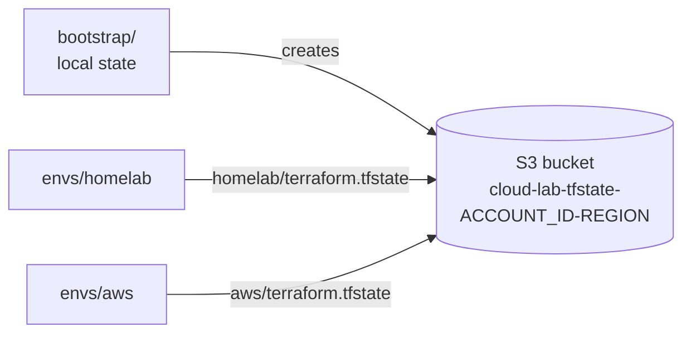

# Architecture

`cloud-lab` is one Terraform codebase that drives two very different targets: a **real Proxmox homelab**
and **AWS**. Both environments share the same modules where it makes sense, and they keep their state in the
same S3 bucket.

## Overview

## Repository layout

| Path | What it is |
|---|---|
| `bootstrap/` | Creates the S3 bucket that stores the state. Local state; also holds the monthly budget |
| `envs/homelab/` | Proxmox environment: VMs from `vm-proxmox` and `cloud-init`, with HTTP checks |
| `envs/aws/` | AWS environment: network, security groups, ALB and an EC2 instance |
| `modules/` | `cloud-init`, `vm-proxmox`, `vm-aws`, `network-aws`. Each one has its own README |
| `docs/decisions/` | Architecture decision records |

Each root has its own `versions.tf`, `providers.tf` and lockfile, so the three can be planned and applied independently.

## Homelab environment

- **Provider**: `bpg/proxmox`. It talks to the Proxmox API and uses SSH (a dedicated user without sudo) only
  to upload cloud-config snippets.
- **VMs**: `vm-proxmox` clones a Debian cloud-init template. The user data is rendered once by `cloud-init`,
  uploaded as a snippet and attached to the VM. The QEMU guest agent reports the IP back to Terraform.
- **Many VMs, one block**: `for_each` over a map of VMs. Names, IDs and IPs are validated by `validation`,
  `precondition` and `postcondition`.
- **Checks**: two `check` blocks request the nginx page of each VM. A failure is a warning, not a blocker.

## AWS environment

- **Network** (`network-aws`): a VPC with one public and one private subnet per AZ. Private subnets reach
  the Internet through a **single NAT gateway**, so a failure of that AZ cuts outbound traffic from the
  other one (see ADR 0003).
- **Traffic in**: the ALB is the only entry point. The EC2 security group accepts TCP 80 **only from the ALB
  security group**, not from an IP range. The two security groups reference each other by ID.
- **Administration**: no SSH and no key pair. The instance gets an IAM role with `AmazonSSMManagedInstanceCore`
  and is reached with Session Manager. IMDSv2 is required and the root volume is encrypted.
- **Cost control**: the NAT gateway and the ALB bill by the hour, so the environment is applied for a work
  session and destroyed afterwards. The VPC and its subnets cost nothing and stay.

## State

- One bucket, one key per environment. Versioning, server-side encryption, public access block and a
  TLS-only policy are on; `prevent_destroy` guards the bucket against a stray `destroy`.
- **Locking** uses the native S3 lockfile (`use_lockfile = true`), so there is no DynamoDB table.
- The chicken-and-egg problem (the bucket cannot store its own creation state) is solved by `bootstrap/`
  keeping a local state. Why and what it costs → [ADR 0001](decisions/0001-bootstrap-local-state.md).

## Module contract

The two VM modules share a soft contract: `name`, `disk_gb`, `user_data`, `ip_address` in, `id` and `ip` out.
Everything provider-specific stays outside it (CPU and memory on Proxmox, instance type and subnet on AWS).
Details → [`modules/README.md`](../modules/README.md).

## Versions

Roots pin Terraform and providers with `~>`; modules only declare a floor with `>=`, and lockfiles are
committed → [ADR 0002](decisions/0002-version-constraints.md).

## Out of scope for v1

- CI with GitHub Actions and OIDC, and the application running on k3s (planned for v2).
- HTTPS on the ALB (HTTP only).
- A NAT gateway per AZ.
